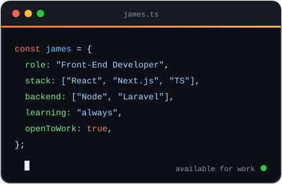

<!-- ===================== HEADER ===================== -->

 

 

  
  
  
  
  

  
  
  

<!-- ===================== NAVIGATION ===================== -->

  
  
  
  
  
  

<!-- ===================== ABOUT ===================== -->
##  About Me

<table width="100%">
<tr>
<td width="55%" valign="middle">

### Hi, I'm James — <i>Digital Craftsman</i>

I build modern, user-focused web applications with **React, Next.js, and TypeScript**, backed by hands-on experience across the **MERN stack** and **PHP/Laravel**.

| | |
|---|---|
| **Focus** | Next.js · React · TypeScript · Tailwind CSS |
| **Backend** | Node.js · Express · MongoDB · MySQL · PHP · Laravel |
| **Values** | Scalable architecture, clean code, thoughtful UX |
| **Learning** | Modern tooling, patterns, and best practices |
| **Looking for** | Projects where maintainability and performance matter |

</td>
<td width="45%" align="center" valign="middle">

</td>
</tr>
</table>

<!-- ===================== TECH STACK ===================== -->
## 🛠️ Tech Stack

<table width="100%">
<tr>
<td width="25%" align="center" valign="top">
<b>🎨 Frontend</b>  

</td>
<td width="25%" align="center" valign="top">
<b>⚙️ Backend & Database</b>  

</td>
<td width="25%" align="center" valign="top">
<b>🧰 Tools</b>  

</td>
<td width="25%" align="center" valign="middle">

 <b>Build • Learn • Improve</b>
</td>
</tr>
</table>

<!-- ===================== ANALYTICS ===================== -->
## 📊 GitHub Analytics

<table width="100%">
<tr>
<td width="50%" align="center" valign="middle">

</td>
<td width="50%" align="center" valign="middle">

</td>
</tr>
</table>

<!-- ===================== STREAK ===================== -->
### 🔥 Contribution Streak

<table width="100%">
<tr>
<td width="25%" align="center" valign="middle">

 <b>Commit • Push • Repeat</b>
</td>
<td width="75%" align="center" valign="middle">

</td>
</tr>
</table>

<!-- ===================== SNAKE ===================== -->
### 🐍 Contribution Activity

<!-- ===================== CONNECT ===================== -->
## 🤝 Let's Connect

  

<i>"Building meaningful applications, learning continuously, and improving one commit at a time."</i> 🚀

  

