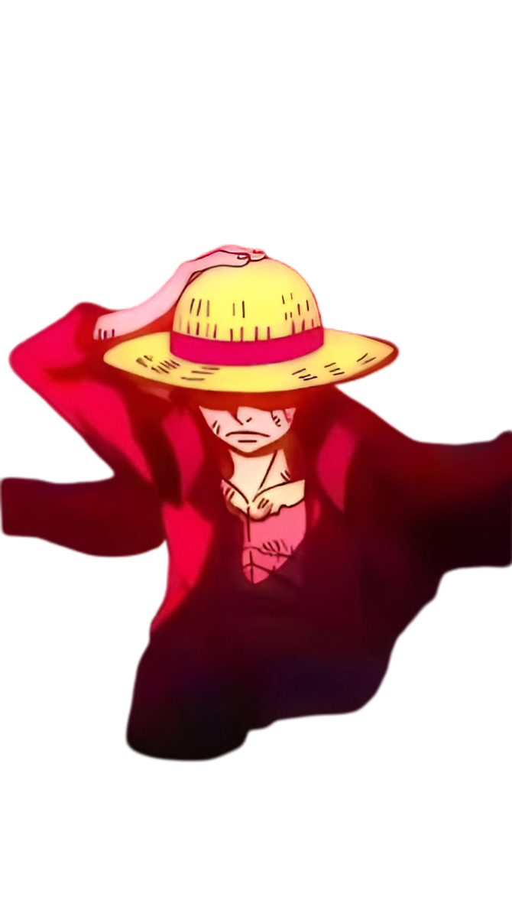
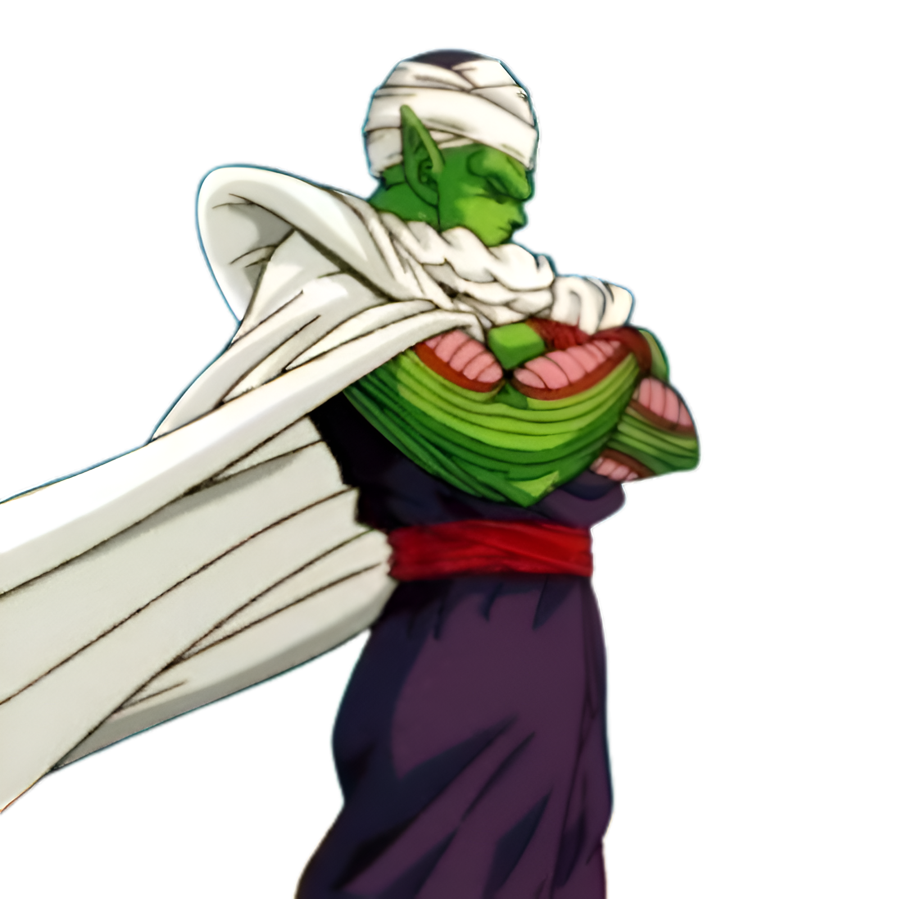

<!-- ================================= -->
<!--          PROFILE HEADER           -->
<!-- ================================= -->

  <!-- Added max-height to fix the banner being too tall -->
  

 

<!-- ================================= -->
<!--         TYPING ANIMATION          -->
<!-- ================================= -->

  

---

<!-- ================================= -->
<!--      INTRO & CAT ANIMATION        -->
<!-- ================================= -->

<table>
  <tr>
    <td valign="top" width="70%">
      <h3>👋 I'm James!</h3>
      
<i>Digital Craftsman (Front-End Developer / MERN Stack)</i>

      
I build modern, user-focused web applications with <b>React, Next.js, and TypeScript</b>, backed by experience in the <b>MERN stack</b> and <b>PHP/Laravel</b>.

      <ul>
        <li>💻 Currently focused on <b>Next.js, React, TypeScript, and Tailwind CSS</b></li>
        <li>⚙️ Experienced with <b>Node.js, Express, MongoDB, MySQL, PHP, and Laravel</b></li>
        <li>🧩 I care about <b>scalable architecture, clean code, and thoughtful UX</b></li>
        <li>🌱 Continuously learning modern tooling, patterns, and best practices</li>
        <li>🚀 Looking to contribute to projects where <b>maintainability and performance matter</b></li>
      </ul>
    </td>
    <td valign="top" width="30%" align="center">
      <!-- TYPING CAT IS BACK -->
      
    </td>
  </tr>
</table>

---

<!-- ================================= -->
<!--      TECH STACK & LUFFY           -->
<!-- ================================= -->

<h2 align="left">🛠️ Tech Stack</h2>

<!-- IMPORTANT: Do not leave blank lines inside this table, or GitHub will break it -->
<table>
  <tr>
    <td valign="top" width="75%">
      <b>Frontend</b> 
        
      <b>Backend</b> 
        
      <b>Database & Tools</b> 
      
    </td>
    <td valign="top" width="25%" align="center">
      <!-- LUFFY GOES ON THE RIGHT -->
      
    </td>
  </tr>
</table>

---

<!-- ================================= -->
<!--         GITHUB ANALYTICS          -->
<!-- ================================= -->

<h2 align="left">📊 GitHub Analytics</h2>

<!-- IMPORTANT: Do not leave blank lines inside this table -->
<table>
  <tr>
    <td valign="middle" width="20%" align="center">
      <!-- PICCOLO GOES ON THE LEFT -->
      
    </td>
    <td valign="middle" width="80%" align="center">
      
      
    </td>
  </tr>
</table>

---

## 🔥 Contribution Streak

  

---

## 🐍 Contribution Activity

  

---

<!-- ================================= -->
<!--            FOOTER                 -->
<!-- ================================= -->

  <i>"Building meaningful applications, learning continuously, and improving one commit at a time." 🚀</i>

  

