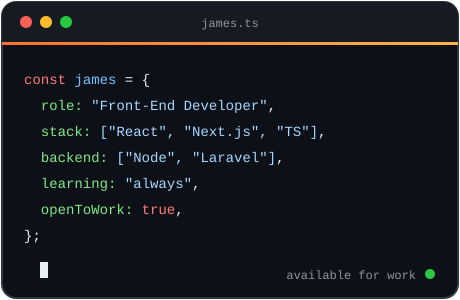

# 👋 Hi, I'm James Mendoza

 

 

  

  

<a href="#-about-me">\\</a>
<a href="#-tech-stack">\\</a>
\<a href="#-github-analytics">\\</a>
\<a href="#-contribution-activity">\\</a>
\<a href="#-lets-connect">\\</a>

\

\

## 👨‍💻 About Me

\<table width="100%">
\<tr>
\<td width="58%" valign="middle">

### Hi, I'm James — Digital Craftsman.

I'm a developer passionate about building modern, responsive, and user-focused web applications.

I primarily work with **React, Next.js, and TypeScript**, while also exploring full-stack development through the **MERN stack and PHP/Laravel**.

I enjoy turning ideas into functional applications, writing maintainable code, solving problems, and continuously improving my development skills.

**What I focus on:**

- Building responsive and accessible user interfaces.
- Developing scalable full-stack applications.
- Creating reliable APIs and backend services.
- Designing maintainable database structures.
- Learning modern development tools and best practices.

\</td>
\<td width="42%" align="center" valign="middle">

\

\</td>
\</tr>
\</table>

\

## 🛠️ Tech Stack

\<table width="100%"> \<tr> \<td width="33%" align="center" valign="top">

### 🎨 Frontend

\

\</td>
\<td width="33%" align="center" valign="top">

### ⚙️ Backend & Database

\

\</td>
\<td width="33%" align="center" valign="top">

### 🧰 Development Tools

\

\</td> \</tr> \</table>

\

\

**Build • Learn • Improve • Repeat**

\

\

## 📊 GitHub Analytics

\

\<table width="100%">
\<tr>
\<td width="50%" align="center">

\

\</td>
\<td width="50%" align="center">

\

\</td>
\</tr>
\</table>

\

\

## 🔥 Contribution Streak

\

\

\ \ 

\

**Commit • Push • Repeat**

\

\

## 🐍 Contribution Activity

\

\

\

\

## 🤝 Let's Connect

\

\<a href="[https://github.com/Ememman](https://github.com/Ememman)">
\
\</a>

\ \ 

\<i>"Building meaningful applications, learning continuously, and improving one commit at a time."\</i>

\ \ 

\

\ 

\

\

